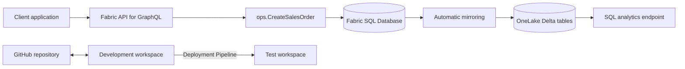

# Fabric Operational Sales API

[](#)
[](#)
[](#)
[](#)
[](LICENSE)

A Microsoft Fabric portfolio project demonstrating a secure translytical architecture that combines transactional sales-order processing, automatic OneLake mirroring, read-only analytical access, a controlled GraphQL API, native Git integration, and a Development-to-Test Deployment Pipeline.

## Business scenario

A sales application must:

- create customer orders through a controlled write path
- validate customers, products, quantities, pricing, discounts, and due dates
- protect against duplicate client requests
- commit an order header and line atomically
- roll back the complete operation on failure
- expose operational data through a programmatic API
- make operational data available for analytics without directing analytical queries to the transactional workload
- promote database and API definitions from Development to Test without copying Development operational data

## Architecture



## Fabric components

| Component | Purpose |
| --- | --- |
| Fabric SQL Database | Transactional source for reference data and operational orders. |
| `SalesLT` schema | AdventureWorksLT-derived customer and product reference data. |
| `ops` schema | Controlled operational order model. |
| `ops.CreateSalesOrder` | Transactional write procedure for a single-line order. |
| API for GraphQL | Read queries and the controlled stored-procedure mutation. |
| Automatic mirroring | Replicates supported SQL tables to OneLake. |
| SQL analytics endpoint | Read-only analytical access to mirrored data. |
| GitHub integration | Source control for Fabric-generated database and GraphQL definitions. |
| Deployment Pipeline | Promotes definitions and metadata from Development to Test. |

## Operational data model

### `ops.SalesOrder`

Stores the order header and includes:

- identity primary key `SalesOrderID`
- unique, non-null `ClientOrderReference`
- customer foreign key
- UTC order and modification timestamps
- due date
- controlled order status
- `decimal(19,4)` subtotal

Validated constraints include:

- unique index on `ClientOrderReference`
- foreign key to `SalesLT.Customer`
- `DueDate >= OrderDate`
- `OrderStatus` limited to `Pending`, `Confirmed`, or `Cancelled`
- nonnegative `SubTotal`

### `ops.SalesOrderLine`

Stores one product line and includes:

- identity primary key `SalesOrderLineID`
- foreign keys to `ops.SalesOrder` and `SalesLT.Product`
- positive `smallint` quantity
- captured `decimal(19,4)` unit price
- `decimal(9,4)` discount constrained to the range `0` to `1`
- persisted computed `LineTotal`
- UTC modification timestamp

`LineTotal` is calculated by SQL Database as:

```sql
CONVERT(
    decimal(19, 4),
    OrderQuantity * UnitPrice * (1 - UnitPriceDiscount)
)
```

A unique index on `(SalesOrderID, ProductID)` prevents the same product from appearing more than once in one order.

### `ops.vwSalesOrderDetails`

Provides a joined operational view containing order, customer, company, product, quantity, captured price, discount, and total information.

## Controlled transactional write path

The `ops.CreateSalesOrder` procedure creates a single-line order and implements:

1. required client request identifier validation
2. positive quantity validation
3. discount validation between `0` and `1`
4. due-date validation
5. customer existence validation
6. product existence and sale-availability validation
7. current product-price capture
8. subtotal calculation with fixed-precision decimal types
9. header and line insertion in one transaction
10. rollback through `TRY/CATCH`, `XACT_STATE()`, and `XACT_ABORT`
11. return of the created order identifiers and calculated values

### Duplicate-request protection

`ClientOrderReference` is protected by a unique database index. Two concurrent requests cannot create duplicate orders with the same reference.

This is **duplicate-request protection**, not full repeatable-response idempotency. A repeated reference is rejected by the database rather than returning the previously created `SalesOrderID`.

## GraphQL API

The `OperationalSalesApi` item exposes the following read operations:

- `salesOrders`
- `salesOrder_by_pk`
- `salesOrderLines`
- `salesOrderLine_by_pk`

List queries support filtering, ordering, cursor pagination, grouping, and numeric aggregation.

### Controlled mutation

```text
executeCreateSalesOrder
```

The mutation maps to `ops.CreateSalesOrder` and returns:

- `SalesOrderID`
- `ClientOrderReference`
- `CustomerID`
- `ProductID`
- `OrderQuantity`
- `UnitPrice`
- `UnitPriceDiscount`
- `SubTotal`
- `Result`

Direct create, update, and delete mutations for `SalesOrder` and `SalesOrderLine` are disabled in the Fabric API configuration. Applications must use `executeCreateSalesOrder`, preserving SQL validation and transactional integrity.

### GraphQL contract limitation

The exported GraphQL SDL represents the stored-procedure arguments as nullable even though SQL logically requires most of them:

- `ClientOrderReference`
- `CustomerID`
- `ProductID`
- `OrderQuantity`
- `DueDate`

SQL procedure validation and table constraints still protect data integrity, but generated GraphQL clients can treat required inputs as optional. `UnitPriceDiscount` is intentionally optional because the procedure defaults it to `0`.

GraphQL introspection is disabled for requests. The schema is reviewed through Fabric's native **Export schema** function.

## Security model

The project implements least privilege with two database roles.

### `ops_api_reader`

Granted `SELECT` on:

- `ops.SalesOrder`
- `ops.SalesOrderLine`
- `ops.vwSalesOrderDetails`

### `ops_api_writer`

Granted:

- `EXECUTE` on `ops.CreateSalesOrder`

Explicitly denied on both operational tables:

- `INSERT`
- `UPDATE`
- `DELETE`

This prevents the API write identity from bypassing procedure validation, price capture, transaction handling, constraints, and rollback behavior.

No passwords, tokens, credentials, or connection strings are stored in the repository.

## OneLake analytics

Microsoft Fabric automatically mirrors supported SQL tables to OneLake. The SQL analytics endpoint:

- provides read-only analytical access
- separates analytical queries from the transactional workload
- exposes mirrored operational and reference tables
- reflects environment-specific operational data independently of Deployment Pipeline promotion

### Verified endpoint state

At audit time, the source SQL Database and its SQL analytics endpoint both contained:

| Table | Source SQL Database | SQL analytics endpoint |
| --- | ---: | ---: |
| `ops.SalesOrder` | 2 | 2 |
| `ops.SalesOrderLine` | 2 | 2 |

The endpoint was therefore current with the transactional source at the time of validation.

### Mirroring limitations

- Mirroring is asynchronous.
- Replication-monitor row counts can temporarily represent an earlier completed state.
- The persisted computed column `LineTotal` is not exposed in the SQL analytics endpoint.
- `LineTotal` must be recalculated analytically from quantity, unit price, and discount.
- `ClientOrderReference`, stored as `uniqueidentifier` in the source database, is represented as `varchar` in the SQL analytics endpoint.

## Validation results

### Development

Validated results include:

- 847 AdventureWorksLT customers
- 295 AdventureWorksLT products
- 32 AdventureWorksLT sample sales-order headers
- 542 AdventureWorksLT sample sales-order lines
- transactional order creation
- duplicate-request protection
- invalid quantity rejection
- nonexistent customer rejection
- nonexistent product rejection
- complete transaction rollback on failure
- GraphQL read operations
- stored-procedure GraphQL mutation
- disabled direct table mutations
- least-privilege database roles
- automatic OneLake mirroring
- current SQL analytics endpoint row counts

### Test

Validated results include:

- SQL Database definition deployed successfully
- GraphQL API definition deployed successfully
- associated SQL analytics endpoint created
- direct table mutations remained disabled
- stored-procedure mutation remained available
- minimal reference data created independently
- SQL procedure execution validated
- GraphQL mutation execution validated
- automatic mirroring validated
- Development operational data was not copied

The Test environment contained:

| Table | Rows |
| --- | ---: |
| `SalesLT.Customer` | 1 |
| `SalesLT.Product` | 1 |
| `ops.SalesOrder` | 2 |
| `ops.SalesOrderLine` | 2 |

Data independence was confirmed through different database identifiers, `ClientOrderReference` prefixes, products, monetary values, order identifiers, and timestamps between Development and Test.

## CI/CD

The project uses:

- native GitHub source control
- Fabric SQL Database project representation
- GraphQL API definition as code
- separate Development and Test workspaces
- a two-stage Fabric Deployment Pipeline

The verified promotion path is:

```text
Development --> Test
```

The latest observed deployment completed successfully. Deployment moves definitions and metadata, not operational data. Environment-specific reference and transactional data remain isolated.

## Repository structure

```text
fabric-operational-sales-api/
├── OperationalSalesApi.GraphQLApi/
├── OperationalSalesDatabase.SQLDatabase/
├── docs/
│   ├── OPERATIONS.md
│   ├── RESTORE.md
│   └── VALIDATION.sql
├── screenshots/
├── LICENSE
└── README.md
```

Fabric-generated SQL Database and GraphQL definitions are changed in Microsoft Fabric and committed through native Fabric Git integration. They are not edited manually in GitHub.

## Restore considerations

Git restores supported database and GraphQL definitions, but does not restore or recreate all environment state.

Not restored by Git alone:

- operational table data
- transaction history
- backup history
- Microsoft Entra identities
- workspace roles
- item permissions
- secrets and credentials
- capacity assignment
- regional configuration
- environment-specific API access assignments

See [`docs/RESTORE.md`](docs/RESTORE.md) for the restore procedure.

## Operational guidance

- Use `executeCreateSalesOrder` for writes.
- Do not grant direct operational-table DML to the API write identity.
- Use a new `ClientOrderReference` for each intended order.
- Treat duplicate-reference errors as duplicate-request protection.
- Refresh GraphQL metadata after supported database-schema changes.
- Monitor OneLake replication before validating analytical freshness.
- Recalculate `LineTotal` in analytical queries when the mirrored endpoint omits it.
- Validate identities, permissions, and environment-specific configuration after deployment or restore.

See [`docs/OPERATIONS.md`](docs/OPERATIONS.md) for operational procedures.

## Validation assets

- [`docs/VALIDATION.sql`](docs/VALIDATION.sql)
- [`docs/RESTORE.md`](docs/RESTORE.md)
- [`docs/OPERATIONS.md`](docs/OPERATIONS.md)

## Known limitations

- Fabric Trial capacity limits apply.
- SQL Database deployment through Deployment Pipeline may be presented as a preview capability in the Fabric interface.
- GraphQL can return generic messages for some stored-procedure errors.
- Stored-procedure arguments appear nullable in the exported GraphQL SDL even when SQL logically requires them.
- GraphQL schema metadata must be refreshed after relevant database-schema changes.
- GraphQL introspection is disabled for requests.
- OneLake mirroring is asynchronous.
- Replication-monitor counts can lag behind the current source state.
- Computed columns such as `LineTotal` are not exposed in the mirrored SQL analytics endpoint.
- Some source SQL types can have different analytical representations, such as `uniqueidentifier` appearing as `varchar`.
- Database-level settings such as collation are not fully represented by Git integration.

## AI-assisted development disclosure

Developed by Kamil Soszka with Microsoft Copilot used as the sole AI-assisted development partner for architecture review, SQL and GraphQL refinement, documentation, validation, and troubleshooting. All environment operations, implementation decisions, testing, and final acceptance were performed by the project owner.

## Skills demonstrated

- Microsoft Fabric SQL Database
- transactional SQL and stored procedures
- GraphQL API design
- database roles and least privilege
- OneLake automatic mirroring
- SQL analytics endpoint
- GitHub integration
- Fabric Deployment Pipelines
- Development and Test environment isolation
- translytical architecture
- validation and technical documentation

## License

This project is licensed under the MIT License. See [LICENSE](LICENSE) for details.
