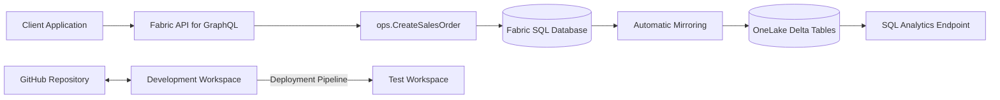

# Fabric Operational Sales API

A Microsoft Fabric portfolio project demonstrating a secure translytical architecture that combines operational order processing, automatic OneLake replication, analytical access, GraphQL API integration, and controlled CI/CD.

## Business Scenario

A sales application must:

- create customer orders safely;
- validate customers, products, quantities, pricing, and discounts;
- prevent duplicate requests;
- commit the order header and line atomically;
- expose orders through a programmatic API;
- make operational data available for analytics without querying the transactional workload directly;
- promote database and API definitions from Development to Test.

## Architecture



## Fabric Components

- SQL database in Microsoft Fabric
- AdventureWorksLT reference data
- Operational `ops` schema
- Stored procedure-based transactional writes
- API for GraphQL
- Automatic mirroring to OneLake
- Read-only SQL analytics endpoint
- GitHub integration
- Deployment Pipeline: Development → Test

## Operational Data Model

### `ops.SalesOrder`

Stores the order header, customer reference, status, dates, subtotal, and idempotency key.

### `ops.SalesOrderLine`

Stores the product, quantity, captured unit price, discount, and calculated line total.

### `ops.vwSalesOrderDetails`

Provides a joined operational view containing order, customer, company, product, quantity, price, discount, and total information.

### `ops.CreateSalesOrder`

Implements the controlled write path:

1. validates the client request identifier;
2. validates quantity and discount;
3. validates the customer;
4. validates product availability;
5. captures the current product price;
6. calculates the subtotal;
7. inserts the header and line in one transaction;
8. rolls back the complete operation on failure.

## GraphQL API

The `OperationalSalesApi` item exposes:

### Queries

- `salesOrders`
- `salesOrder_by_pk`
- `salesOrderLines`
- `salesOrderLine_by_pk`

### Controlled Mutation

- `executeCreateSalesOrder`

Direct table mutations are disabled. Applications must use the stored-procedure mutation so that SQL validation and transactional integrity cannot be bypassed.

## Security

The project defines two database roles:

### `ops_api_reader`

Granted `SELECT` access to:

- `ops.SalesOrder`
- `ops.SalesOrderLine`
- `ops.vwSalesOrderDetails`

### `ops_api_writer`

Granted:

- `EXECUTE` on `ops.CreateSalesOrder`

Explicitly denied:

- direct `INSERT`
- direct `UPDATE`
- direct `DELETE`

on both operational tables.

No passwords, tokens, credentials, or connection strings are stored in the repository.

## OneLake Analytics

Fabric automatically mirrors supported SQL tables to OneLake.

The SQL analytics endpoint:

- provides read-only analytical access;
- does not allow DML operations;
- separates analytical queries from the operational workload;
- can expose operational changes shortly after transaction commit.

Computed columns such as `LineTotal` are not replicated to OneLake and must be recalculated analytically when required.

## Validation Results

### Development

- AdventureWorksLT reference data loaded successfully
- 847 customers
- 295 products
- 32 sample sales-order headers
- 542 sample sales-order lines
- transactional order creation validated
- duplicate request protection validated
- invalid quantity rejected
- nonexistent customer rejected
- nonexistent product rejected
- rollback confirmed
- GraphQL query validated
- stored-procedure GraphQL mutation validated
- automatic OneLake replication validated
- SQL analytics endpoint read-only behavior validated

### Test

- database schema deployed successfully
- GraphQL API deployed successfully
- direct table mutations remained disabled
- stored-procedure mutation remained enabled
- Development transactional data was not copied
- synthetic reference data was created independently
- SQL procedure execution validated
- GraphQL mutation execution validated
- automatic mirroring to OneLake validated

## CI/CD

The project uses:

- GitHub source control;
- Fabric SQL database project representation;
- GraphQL API definition as code;
- separate Development and Test workspaces;
- a two-stage Fabric Deployment Pipeline.

Deployment moves definitions and metadata, not operational data.

## Repository Structure

```text
OperationalSalesApi.GraphQLApi/
OperationalSalesDatabase.SQLDatabase/
docs/
README.md
LICENSE
```

## Restore Considerations

Git restores database and GraphQL definitions, but does not restore:

- operational table data;
- transaction history;
- backup history;
- Microsoft Entra identities;
- workspace roles;
- item permissions;
- secrets or credentials;
- capacity and regional configuration.

See `docs/RESTORE.md` for the complete restore procedure.

## Known Limitations

- Fabric Trial capacity limits apply.
- The Deployment Pipeline interface marks SQL database deployment as Preview.
- GraphQL returns generic messages for some stored-procedure errors.
- GraphQL schema metadata must be refreshed after database schema changes.
- OneLake replication is asynchronous.
- Computed columns are not mirrored.
- Database-level settings such as collation are not fully represented by Git integration.

## Documentation

- `docs/RESTORE.md`
- `docs/VALIDATION.sql`
- `docs/OPERATIONS.md`

## License

This project is licensed under the MIT License.
